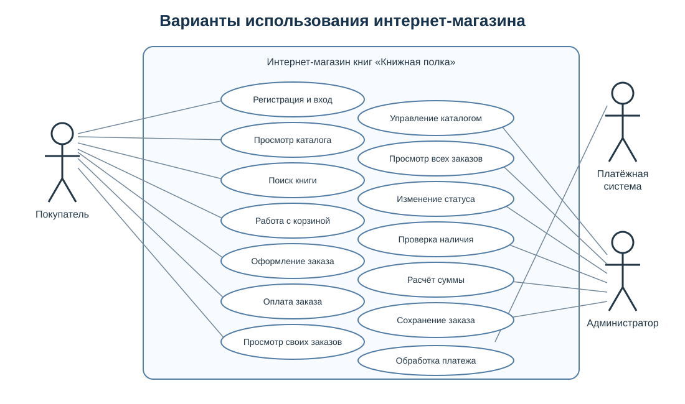
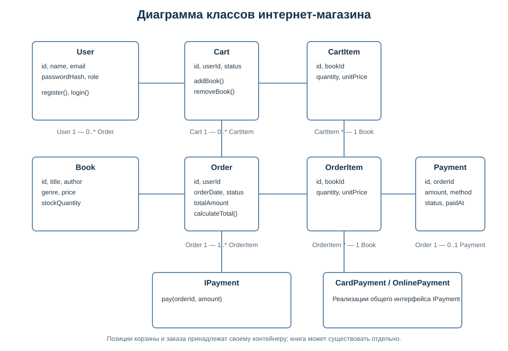
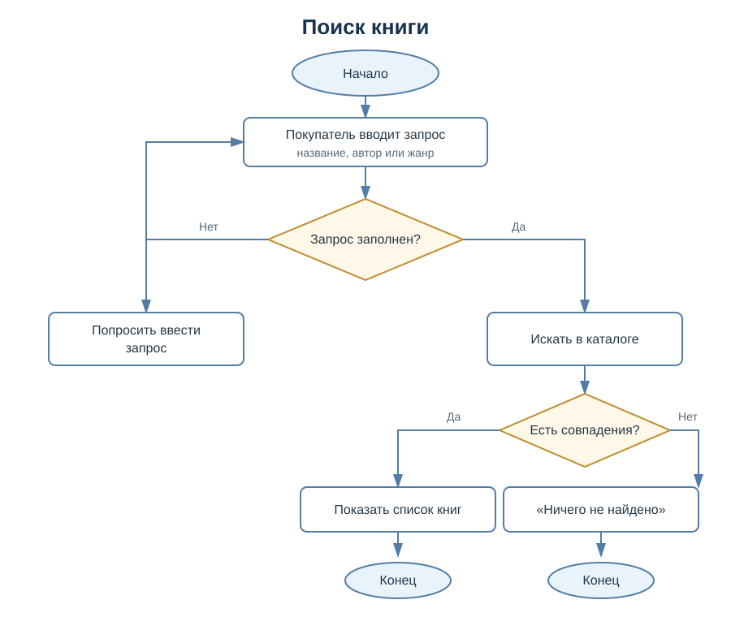
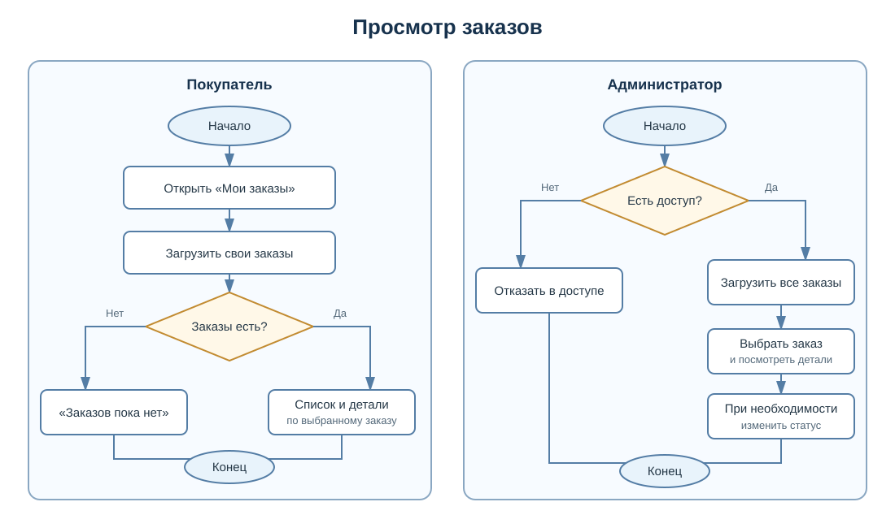
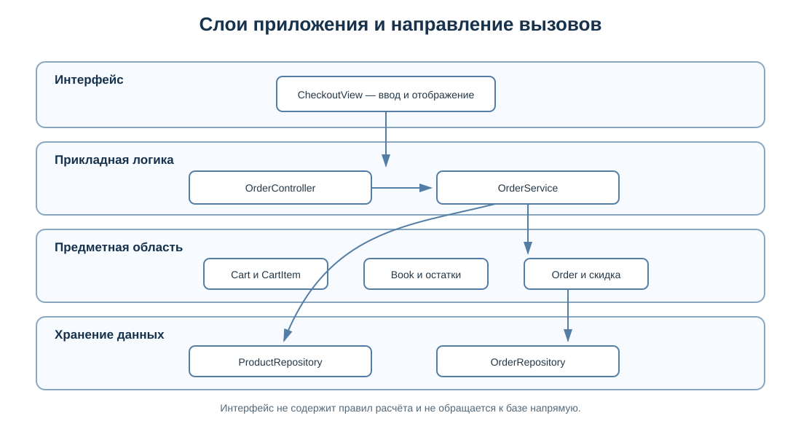
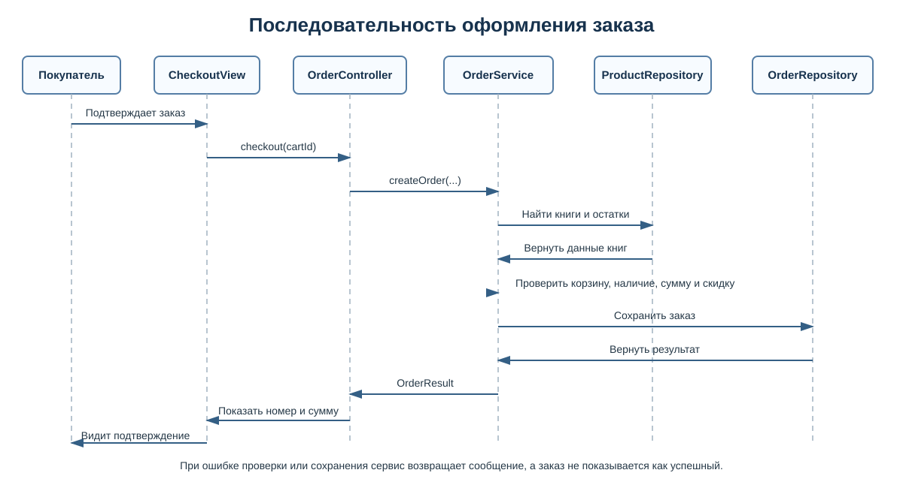
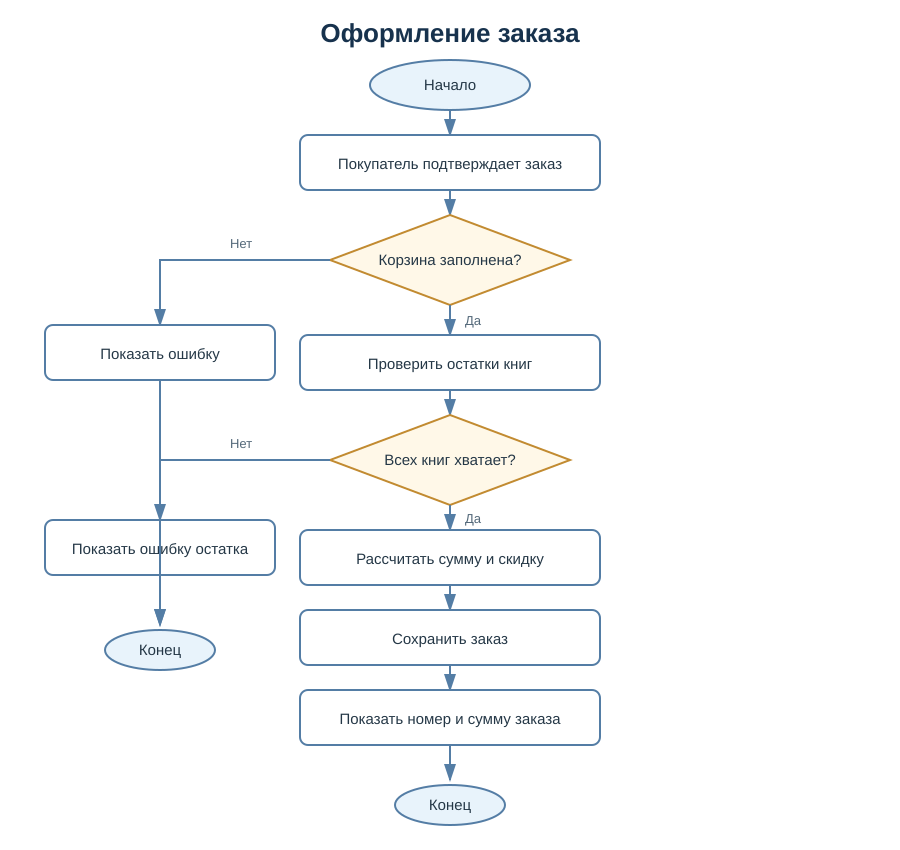

# Интернет-магазин книг

## О работе

Мы выбрали для практической работы интернет-магазин книг «Книжная полка». Покупатель может посмотреть каталог, найти книгу, добавить её в корзину и оформить заказ. Администратор управляет книгами и заказами.

В README описаны требования и основные данные магазина. Схемы показаны ниже как картинки. Чтобы открыть их и редактировать в diagrams.net, скачай файл [knizhny-magazin-diagrams.drawio](knizhny-magazin-diagrams.drawio). В нём каждая схема находится на отдельной странице.

## 1. Требования к системе

### Бизнес-требования

| ID | Требование |
|---|---|
| BR-01 | Покупатель может зарегистрироваться и войти в систему. |
| BR-02 | Покупатель может просматривать каталог книг. |
| BR-03 | Покупатель может искать книгу по названию, автору или жанру. |
| BR-04 | Покупатель может добавлять книги в корзину, менять количество и удалять позиции. |
| BR-05 | Покупатель может оформить заказ. |
| BR-06 | Покупатель может оплатить заказ. |
| BR-07 | Покупатель может посмотреть свои заказы и их статус. |
| BR-08 | Администратор может добавлять, изменять и скрывать книги. |
| BR-09 | Администратор может просматривать заказы и менять их статус. |

### Функциональные требования

Система показывает каталог и карточку книги, выполняет поиск, хранит корзину, проверяет остатки перед заказом и рассчитывает сумму. После оформления заказ сохраняется. Покупатель видит только свои заказы, а администратор — все заказы и может изменить их статус.

### Нефункциональные требования

- Пароли хранятся в защищённом виде.
- Информация об оформленных заказах не теряется.
- В системе могут одновременно работать несколько покупателей.
- Каталог и поиск должны открываться без долгого ожидания.
- Интерфейс должен быть понятным для покупателя.

## 2. Основные сущности

| Сущность | Для чего нужна | Идентификатор и основные атрибуты |
|---|---|---|
| `User` | Покупатель или администратор | `id`, `name`, `email`, `passwordHash`, `role` |
| `Book` | Книга в каталоге | `id`, `title`, `author`, `genre`, `price`, `stockQuantity` |
| `Cart` | Корзина покупателя | `id`, `userId`, `createdAt`, `status` |
| `CartItem` | Книга в корзине | `id`, `cartId`, `bookId`, `quantity`, `unitPrice` |
| `Order` | Оформленный заказ | `id`, `userId`, `orderDate`, `status`, `totalAmount` |
| `OrderItem` | Книга в заказе | `id`, `orderId`, `bookId`, `quantity`, `unitPrice` |
| `Payment` | Оплата заказа | `id`, `orderId`, `amount`, `method`, `status` |

В каждой сущности есть `id`. В позиции заказа сохраняется цена книги на момент покупки. Поэтому изменение цены в каталоге не меняет уже оформленные заказы.

## 3. Применение SOLID

| Класс | Принцип | Какую проблему решает |
|---|---|---|
| `BookCatalogService` | **S — Single Responsibility** | Работает с каталогом и поиском. Логика заказа не смешивается с каталогом. |
| `OrderService` | **S — Single Responsibility** | Отвечает за оформление заказа, а отображение окон остаётся в интерфейсе. |
| `IPayment` | **O — Open/Closed** | Для нового способа оплаты добавляется отдельный класс, существующий сервис заказа менять не нужно. |
| `CardPayment`, `OnlinePayment` | **L — Liskov Substitution** | Оба класса можно использовать вместо `IPayment`, сохраняя общий способ вызова оплаты. |
| `IOrderReader`, `IOrderManager` | **I — Interface Segregation** | Методы просмотра заказов отделены от методов управления ими. Покупателю не нужны функции администратора. |
| `OrderService` | **D — Dependency Inversion** | Сервис заказа работает через интерфейс оплаты, а не привязан к одному платёжному провайдеру. |

## 4. Диаграмма вариантов использования

На схеме показаны покупатель, администратор и платёжная система, а также их основные действия.

## 5. Диаграмма классов магазина

У одного покупателя может быть несколько заказов. Заказ состоит из позиций; каждая позиция относится к книге. Книга может существовать отдельно от корзины и заказа. Способы оплаты используют общий интерфейс.

## 6. Блок-схемы из практической работы по документированию

### Поиск книги

Покупатель вводит запрос. Если поле пустое, система просит ввести текст. Если книги найдены, система показывает список; если нет — сообщает об этом.

### Просмотр заказов

Покупатель видит только собственные заказы. Администратор сначала проходит проверку доступа, после чего может посмотреть все заказы и при необходимости изменить статус.

## 7. Блок I. Разделение интерфейса и логики

В этой части показано, как части программы участвуют в оформлении заказа. Интерфейс принимает действия покупателя и показывает результат. Проверки и расчёты выполняет сервис. Репозитории отвечают за чтение и сохранение данных.

### Сценарий оформления заказа

Покупатель нажимает кнопку оформления заказа. Интерфейс передаёт данные контроллеру, контроллер вызывает `OrderService`. Сервис проверяет корзину и остатки книг, рассчитывает сумму и скидку, создаёт заказ и просит репозиторий его сохранить.

Если корзина пустая или количество указано неверно, заказ не создаётся и покупатель видит сообщение. Если книг не хватает, покупатель может изменить корзину. Если не удалось сохранить заказ, система сообщает об ошибке и не показывает заказ как оформленный.

### Ответственность частей программы

| Часть | Ответственность |
|---|---|
| `CheckoutView` | Принимает действие покупателя и показывает результат или ошибку. Не рассчитывает сумму и не работает с базой. |
| `OrderController` | Передаёт команду от интерфейса сервису. |
| `OrderService` | Проверяет заказ, рассчитывает сумму и скидку, создаёт заказ. |
| `Cart`, `Book`, `Order` | Представляют корзину, книгу и заказ. |
| `ProductRepository` | Находит книги и сообщает их остатки. |
| `OrderRepository` | Сохраняет заказ и позволяет получить его позже. |

Ожидаемое направление вызовов: `CheckoutView → OrderController → OrderService → репозитории`. Интерфейс не обращается к базе напрямую. Реальные репозитории можно заменить учебными заглушками.

### Диаграмма компонентов

### Диаграмма последовательностей

### Блок-схема оформления заказа

## 8. Краткое техническое задание

**Название:** интернет-магазин книг «Книжная полка».  
**Назначение:** помочь покупателям выбирать и заказывать книги через интернет.  
**Пользователи:** покупатель и администратор. Для оплаты используется внешняя платёжная система.  
**Основные функции:** регистрация и вход, каталог, поиск, корзина, оформление и оплата заказа, просмотр заказов, управление книгами и статусами заказов.  
**Архитектура:** интерфейс передаёт действия контроллеру, правила оформления находятся в сервисе, а хранение данных выполняют репозитории.

## Итог

В работе мы разделили интерфейс, логику оформления и хранение данных. Это позволяет менять интерфейс или способ хранения, не переписывая правила заказа. Схемы показывают действия пользователей, устройство программы и ход основных процессов.
