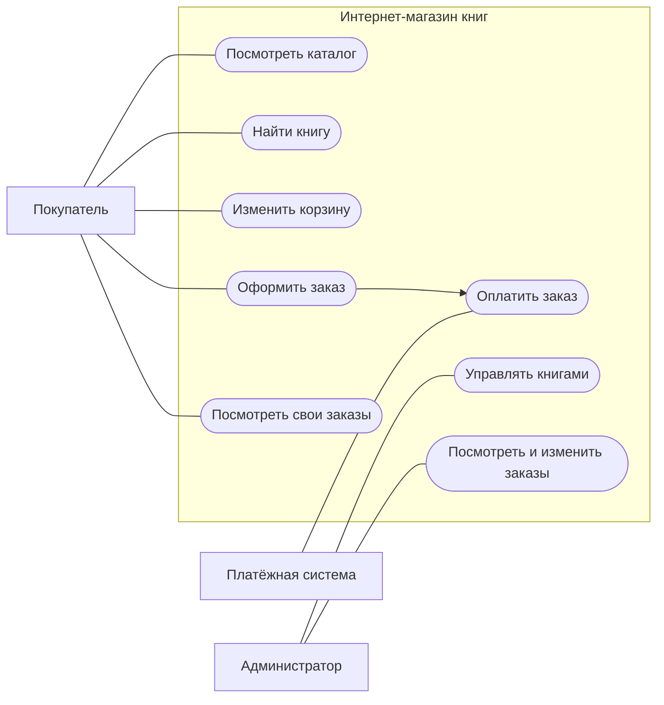
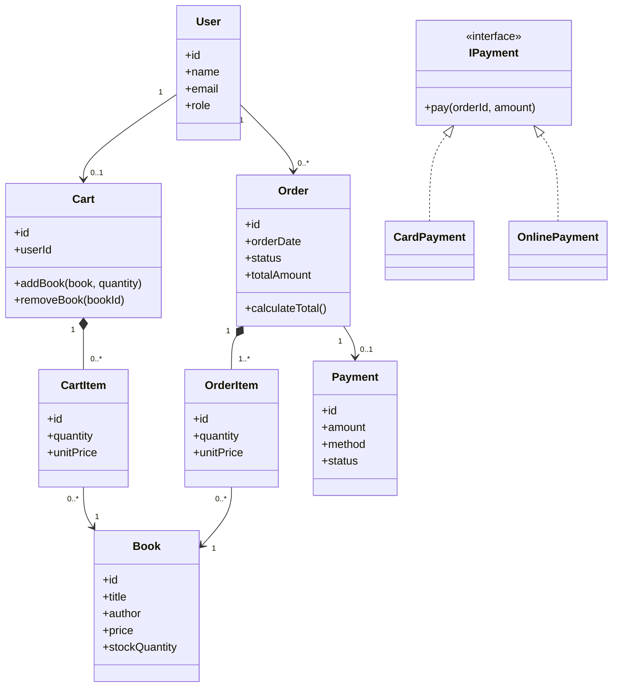
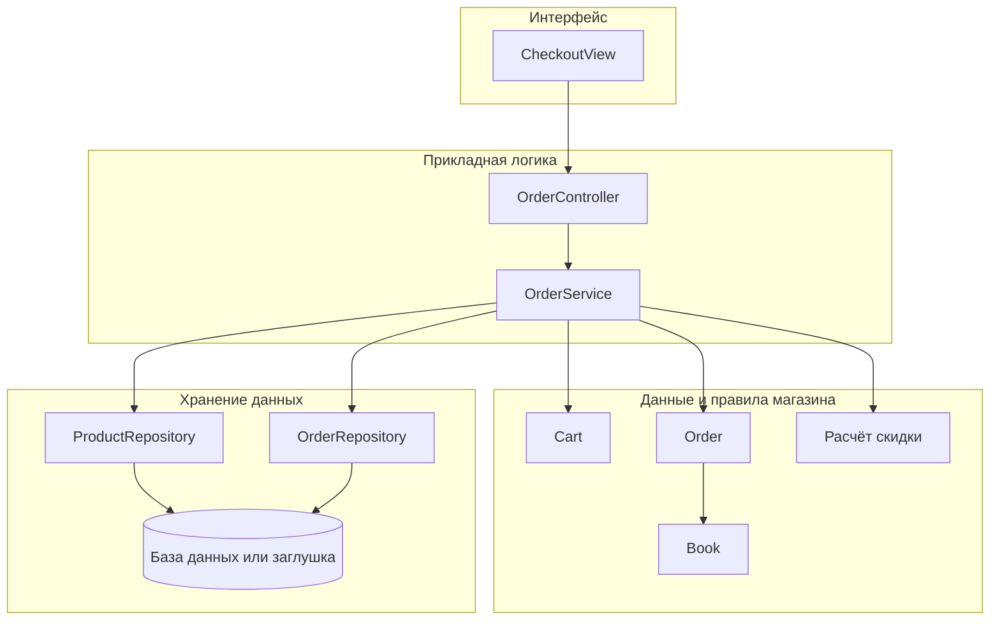
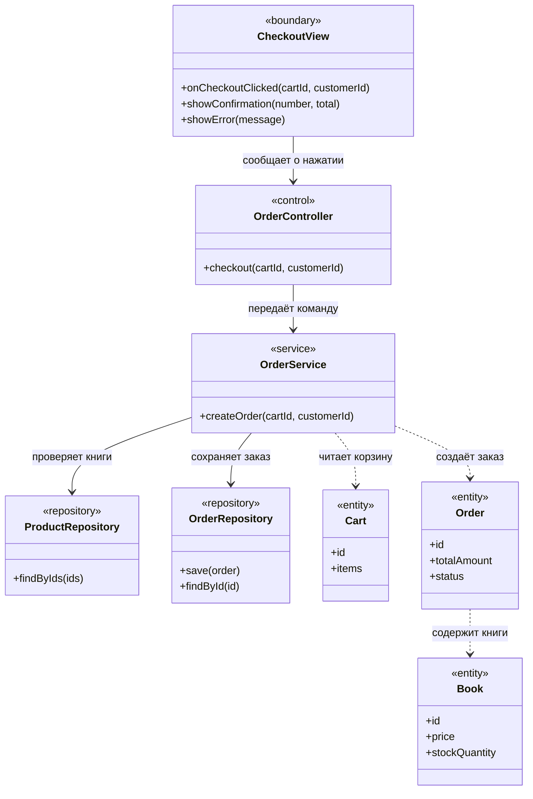
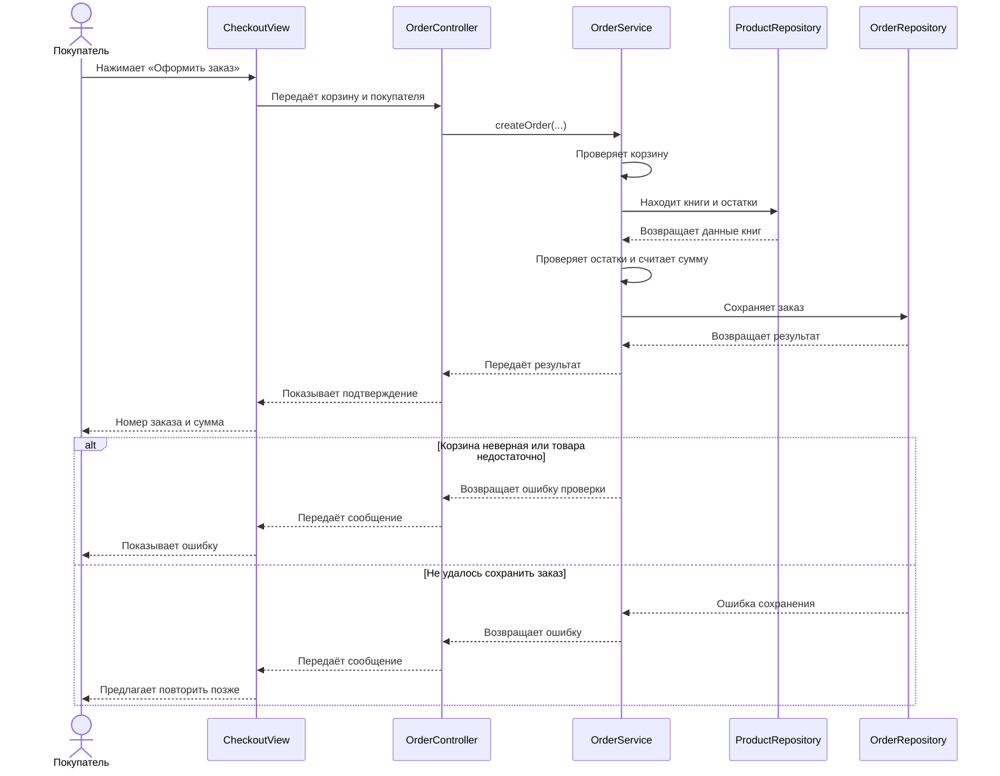

# Интернет-магазин книг

## О работе

В этой работе мы рассматриваем интернет-магазин книг. Покупатель может выбрать книгу, добавить её в корзину и оформить заказ. Администратор следит за каталогом и заказами. В первой части мы описываем систему и показываем, как отделить интерфейс от логики.

## 1. Требования к магазину

### Что должна уметь система

- Покупатель может зарегистрироваться и войти.
- Он может смотреть каталог и искать книги по названию, автору или жанру.
- Книги можно добавлять в корзину, удалять оттуда и менять количество.
- Перед оформлением заказа система проверяет, есть ли книги в наличии.
- Покупатель может оформить заказ, оплатить его и посмотреть его статус.
- Администратор может добавлять и изменять книги, а также менять статус заказа.

### Требования к качеству

Информация о заказах должна сохраняться. Пароли нужно хранить в защищённом виде. В магазине могут одновременно работать разные покупатели. Каталог и поиск должны открываться без долгого ожидания, а пользоваться ими должно быть понятно.

## 2. Основные данные

| Сущность | Для чего нужна | Основные данные |
|---|---|---|
| `User` | Покупатель или администратор | `id`, `name`, `email`, `passwordHash`, `role` |
| `Book` | Книга в каталоге | `id`, `title`, `author`, `genre`, `price`, `stockQuantity` |
| `Cart` | Корзина покупателя | `id`, `userId`, `createdAt`, `status` |
| `CartItem` | Книга в корзине | `id`, `cartId`, `bookId`, `quantity`, `unitPrice` |
| `Order` | Оформленный заказ | `id`, `userId`, `orderDate`, `status`, `totalAmount` |
| `OrderItem` | Книга в заказе | `id`, `orderId`, `bookId`, `quantity`, `unitPrice` |
| `Payment` | Оплата заказа | `id`, `orderId`, `amount`, `method`, `status` |

У каждой сущности есть свой `id`. В заказе сохраняется цена книги на момент покупки, чтобы старые заказы не менялись при изменении цены в каталоге.

## 3. Где применяются принципы SOLID

| Принцип | Пример в магазине |
|---|---|
| **S — Single Responsibility** | `BookCatalogService` занимается каталогом, а `OrderService` — заказами. Так классы не делают всё сразу. |
| **O — Open/Closed** | Для нового способа оплаты можно добавить ещё одну реализацию `IPayment`, не переписывая оформление заказа. |
| **L — Liskov Substitution** | Разные способы оплаты должны работать через общий интерфейс `IPayment` и возвращать понятный результат оплаты. |
| **I — Interface Segregation** | Покупателю нужны методы просмотра своих заказов, а администратору — методы управления заказами. Поэтому интерфейсы можно разделить. |
| **D — Dependency Inversion** | `OrderService` обращается к `IPayment`, а не напрямую к конкретному платёжному сервису. |

## 4. Варианты использования

На схеме показаны покупатель, администратор и платёжная система. Покупатель ищет книги, работает с корзиной и оформляет заказ. Администратор управляет каталогом и заказами.



## 5. Классы и связи

У одного покупателя может быть несколько заказов. В заказ входят позиции, а в позиции записана конкретная книга и её цена. Корзина тоже состоит из позиций. Корзина и заказ хранят список книг, но сами книги существуют отдельно от них.



## 6. Блок I. Разделение интерфейса и логики

### Сценарий оформления заказа

Покупатель нажимает кнопку оформления заказа. Интерфейс передаёт данные контроллеру, а контроллер вызывает `OrderService`. Сервис проверяет корзину и остатки книг, считает сумму и скидку, после чего сохраняет заказ через репозиторий. Если всё прошло успешно, покупатель видит номер заказа и сумму.

Могут возникнуть ошибки:

1. Корзина пустая или количество указано неверно. Заказ не создаётся, покупателю показывается сообщение.
2. Книги не хватает на складе. Сервис сообщает об этом, и покупатель может изменить корзину.
3. Не удалось сохранить заказ. Покупатель видит сообщение об ошибке, а заказ не показывается как оформленный.

### Кто за что отвечает

| Часть программы | Ответственность |
|---|---|
| `CheckoutView` | Получает действия пользователя и показывает результат или ошибку. Не считает скидку и не работает с базой данных. |
| `OrderController` | Получает нажатие кнопки и передаёт команду сервису. |
| `OrderService` | Проверяет заказ, считает сумму и скидку, создаёт заказ и просит его сохранить. |
| `Cart`, `Book`, `Order` | Хранят данные магазина и описывают его основные объекты. |
| `ProductRepository` | Находит книги и узнаёт их остатки. |
| `OrderRepository` | Сохраняет заказ и позволяет найти его позже. |

Ожидаемое направление вызовов: `CheckoutView → OrderController → OrderService → репозитории`. Реальные репозитории могут работать с базой данных, но сервису не нужно знать её детали. Поэтому в учебном примере их можно заменить заглушками.

### Диаграмма компонентов



### Диаграмма классов для оформления заказа



### Диаграмма последовательностей



### Блок-схема оформления заказа

```mermaid
flowchart TD
  start([Начало]) --> click[Покупатель подтверждает заказ]
  click --> check{Корзина заполнена?}
  check -- Нет --> error[Показать сообщение об ошибке]
  check -- Да --> stock[Проверить остатки книг]
  stock --> enough{Всех книг хватает?}
  enough -- Нет --> error
  enough -- Да --> total[Рассчитать сумму и скидку]
  total --> save[Сохранить заказ]
  save --> saved{Заказ сохранён?}
  saved -- Нет --> error
  saved -- Да --> done[Показать номер заказа и сумму]
  error --> finish([Конец])
  done --> finish
```

Эти схемы показывают разные стороны одного процесса: кто пользуется магазином, из каких частей состоит программа, как части обмениваются сообщениями и какие проверки проходят при оформлении заказа. Для этой работы этого достаточно.

## 7. Короткое техническое задание

**Название:** интернет-магазин книг «Книжная полка».  
**Назначение:** дать покупателям возможность выбирать и заказывать книги через интернет.  
**Пользователи:** покупатель и администратор. Для оплаты используется внешняя платёжная система.  
**Основные функции:** каталог, поиск, корзина, оформление заказа, оплата, просмотр заказов и управление каталогом.  
**Архитектура:** интерфейс передаёт действия контроллеру, прикладные правила находятся в сервисе, а сохранением занимаются репозитории.

## Заключение

В этой работе мы разделили интерфейс и логику магазина. Интерфейс показывает информацию и принимает действия покупателя. Проверки и расчёты выполняет сервис, а репозитории отвечают за сохранение данных. Благодаря этому бизнес-логику можно проверять отдельно от графического интерфейса.
